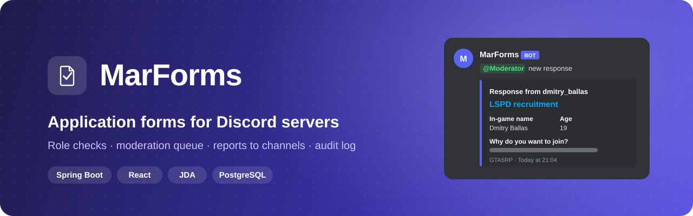
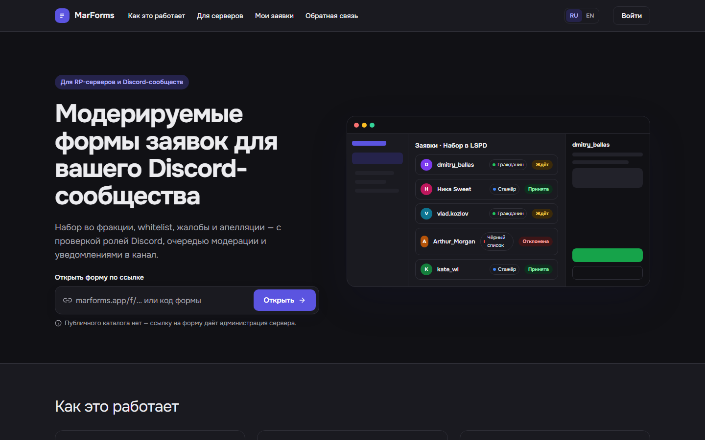
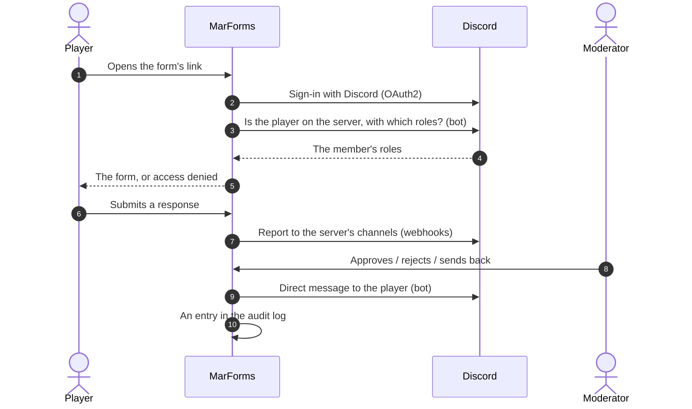
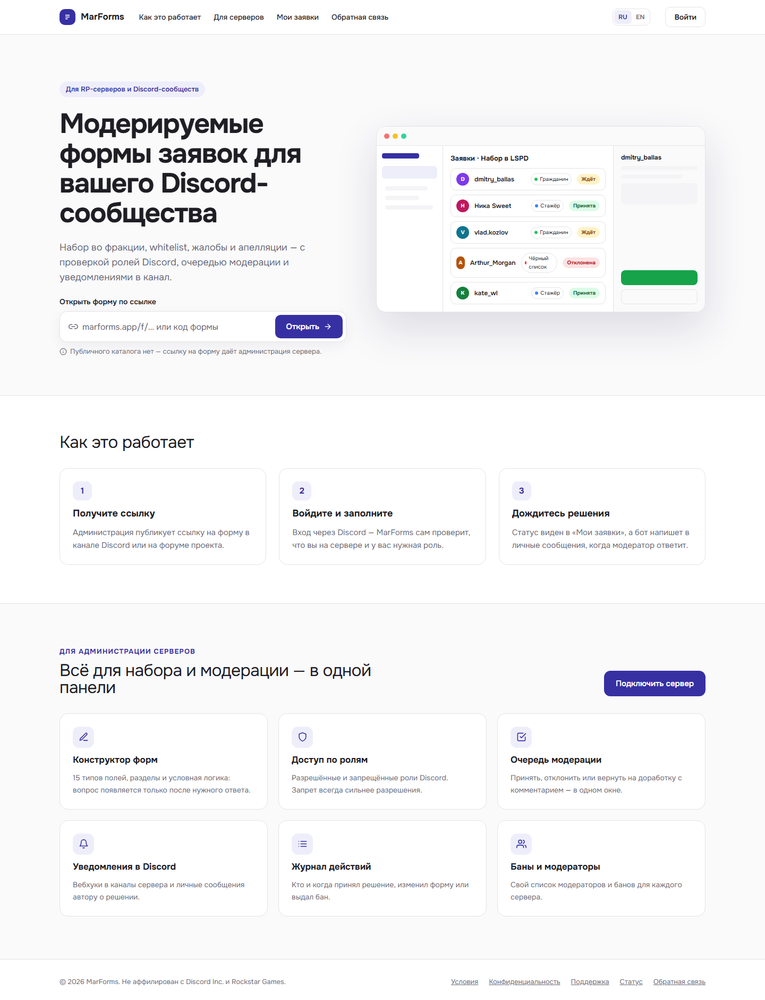
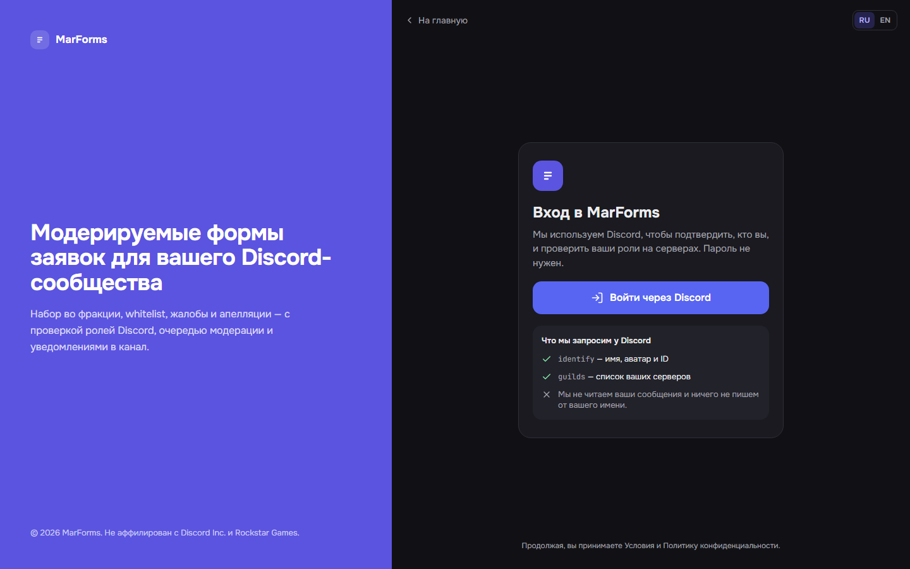
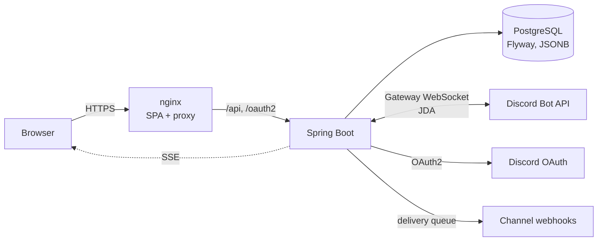

<p align="center">
  
</p>

<p align="center">
  <a href="README.md">Русский</a> · <b>English</b>
</p>

<p align="center">
  <a href="https://github.com/marensovich/MarForms/actions/workflows/ci.yml"></a>
  
  
  
  
  
</p>

<p align="center">
  <a href="#why">Why</a> ·
  <a href="#features">Features</a> ·
  <a href="#how-it-works">How it works</a> ·
  <a href="#quick-start">Quick start</a> ·
  <a href="#architecture">Architecture</a> ·
  <a href="#documentation">Documentation</a>
</p>

---

**MarForms** is a platform for moderated forms for Discord communities and roleplay servers:
faction recruitment, whitelists, complaints, appeals. A player signs in with Discord, and MarForms
itself checks that they are on the server and hold the right roles. The response goes to the
moderators' queue and as a report to Discord channels, and the bot messages the author directly
about the decision.

<p align="center">
  
</p>

> The interface is in Russian and English; the screenshots show the Russian one.

## Why

Recruitment on roleplay servers usually means a Google Form, a link in a channel and a moderator
who checks names against Discord by hand, copies answers into a channel and writes everyone
"you're in". Anyone can submit, nobody checks roles, and a month later nobody knows who decided what.

MarForms closes the whole loop:

| Before | With MarForms |
|---|---|
| Anyone fills in the form | Sign-in with Discord and access by the server's roles, allowed and denied |
| Answers are copied into Discord by hand | The report arrives in the chosen channels, with its own text and embed in each |
| A decision is a moderator's DM | Approve, reject or send back for revision in one place; the bot tells the author |
| "Who approved him?" | An audit log per server, with a live feed |
| One person with access to the spreadsheet | Moderators, admin roles, bans and time-outs per server |

## Features

### For players
- **Sign in with Discord**, no passwords. MarForms asks only for `identify` and `guilds`.
- **"My submissions"**: the status of each form sent and the moderator's comment.
- The decision arrives **as a direct message** from the bot.
- Works on phones, with a **dark theme** and a **Russian / English** interface.

### For moderators
- A **queue of responses** with filters: approve, reject or send back with a comment.
- Review on the site is **optional**: a form can simply post its responses to Discord.
- A user's history of responses, **bans** and **time-outs**.
- **CSV export**.

### For server owners
- A **form builder**: 15 field types (text, choices, dates, ratings, files up to 25 MB and more),
  sections and **conditional logic**: a question appears only after the right answer.
- **Access by Discord roles**: allowed and denied roles, a denial always wins. Open and anonymous
  forms too.
- Opening and closing times, a limit of responses per person, a draft of changes over the
  published form, and **autosave** that guards against two people editing at once.
- **Channel notifications**: the bot creates the webhook in the chosen channel. Each channel has
  its own text with role mentions and its own embed (colour, author, images, footer), with a
  **live preview**.
- **Log channels** on the server: a category with an audit channel, open only to admin roles.
- **The bot's profile per server**: nickname, avatar, banner, description.
- **Audit log**: a run of edits folds into one entry ("15:25 – 15:29 Form updated").

### For the platform
- An admin area: users, roles and permissions, every form and response, system health, settings,
  the bot's status.
- A **feedback** page (bug, idea, problem) posting to the team's webhook.
- **Security**: Discord tokens and webhook URLs are encrypted with AES-GCM, webhook tokens are
  masked in the API, webhooks are rebuilt on `discord.com` only (SSRF), per-IP rate limits.

## How it works



## Screenshots

| Start page | Sign-in |
|---|---|
|  |  |

The sources of every approved screen (builder, moderation, admin area, mobile) are in
[`docs/design/mockups`](docs/design/mockups); how to read them is in [`docs/design/README.md`](docs/design/README.md).

## Quick start

**You need:** JDK 25, Node.js 22, Docker and a Discord application with a bot
([Developer Portal](https://discord.com/developers/applications)).

```bash
# 1. Database
docker compose up -d

# 2. Backend (http://localhost:8090)
cd backend
cp .env.example .env        # Discord client id/secret, bot token, JWT_SECRET, TOKEN_ENCRYPTION_KEY
./gradlew bootRun

# 3. Frontend (http://localhost:5173)
cd ../frontend
npm ci
npm run dev
```

**Production**: Postgres, the backend and the SPA behind nginx on one origin:

```bash
cp backend/.env.example .env
GIT_COMMIT=$(git rev-parse --short HEAD) \
  docker compose -f docker-compose.prod.yml --env-file .env up -d --build
```

Put TLS in front of the `frontend` service. Every environment variable is described in
[`backend/README.md`](backend/README.md#environment-variables).

**Tests:**

```bash
cd backend && ./gradlew test      # H2, plus Postgres via Testcontainers (needs Docker)
cd frontend && npm test && npm run lint
```

## Architecture



| Part | Stack |
|---|---|
| Backend | Java 25, Spring Boot 3.5, Spring Security + OAuth2, Hibernate 6, Flyway, JDA 6 |
| Frontend | React 19, TypeScript, Vite, Tailwind CSS, React Router 7, i18next |
| Data | PostgreSQL 16: form schemas and answers in JSONB |
| Background work | A delivery queue in the database (`SKIP LOCKED`) with retries: webhook reports and decision DMs |
| Tests | JUnit 5, Spring MockMvc, Testcontainers, Vitest, Testing Library |
| Delivery | Docker Compose, nginx, GitHub Actions |

The key decisions are ADRs: [background jobs](docs/adr/0001-background-job-mechanism.md),
[form fields in JSONB](docs/adr/0002-form-fields-in-jsonb.md), [file storage](docs/adr/0003-file-storage.md).

<details>
<summary><b>Repository layout</b></summary>

```
.
├── backend/                 Spring Boot: REST API, the bot (JDA), delivery queue, Flyway migrations
│   └── src/main/resources/db/migration
├── frontend/                React SPA: public forms, server panel, admin area
│   ├── src/components/      screens: builder/, dashboard/, …
│   ├── src/ui/              the UI kit of the mockups
│   └── public/locales/      ru / en translations
├── docs/
│   ├── spec/                requirements
│   ├── adr/                 architecture decisions
│   └── design/              approved screen mockups
├── docker-compose.yml       Postgres for development
└── docker-compose.prod.yml  the whole stack
```
</details>

## Documentation

- [Requirements](docs/spec/business-requirements.md) (Russian): roles, scenarios, requirements.
- [Backend](backend/README.md): API, environment, Discord integrations, background jobs.
- [Design](docs/design/README.md) (Russian): tokens, artboards, how to read the mockups.
- [ADRs](docs/adr): why things are the way they are.

## Status

In active development. Forms, moderation, notifications, logs, server settings and the admin
area are done. **On hold:** the Google Sheets integration (CSV export exists) and paid plans.

## License

© 2026 marensovich. All rights reserved: the code may be viewed, but not used, copied, modified or
distributed without written permission. See [LICENSE](LICENSE).

MarForms is not affiliated with Discord Inc. or Rockstar Games.
