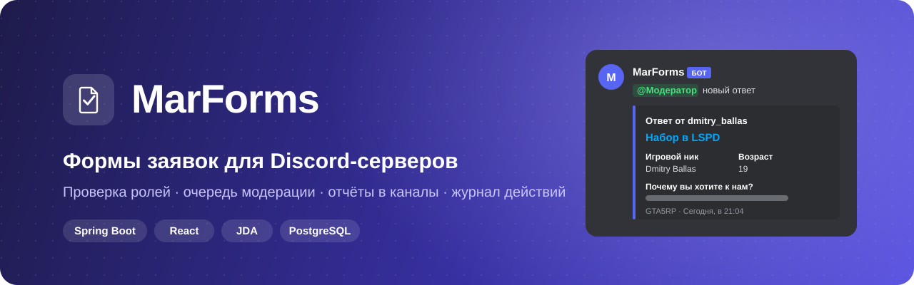
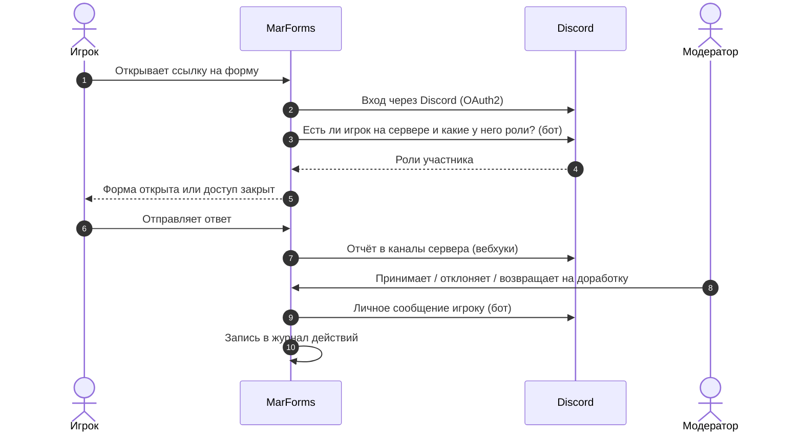
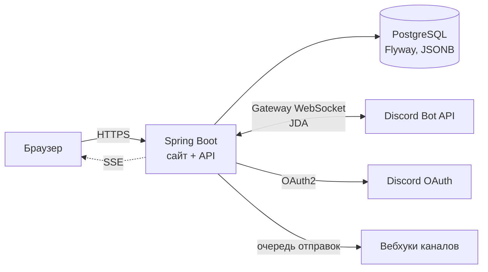

<p align="center">
  
</p>

<p align="center">
  <b>Русский</b> · <a href="README.en.md">English</a>
</p>

<p align="center">
  <a href="https://github.com/marensovich/MarForms/actions/workflows/ci.yml"></a>
  
  
  
  
  
</p>

<p align="center">
  <a href="#зачем">Зачем</a> ·
  <a href="#возможности">Возможности</a> ·
  <a href="#как-это-работает">Как это работает</a> ·
  <a href="#быстрый-старт">Быстрый старт</a> ·
  <a href="#архитектура">Архитектура</a> ·
  <a href="#документация">Документация</a>
</p>

---

**MarForms** — платформа модерируемых форм для Discord-сообществ и RP-серверов: набор во фракции,
whitelist, жалобы, апелляции. Игрок входит через Discord, MarForms сам проверяет, что он на
сервере и у него нужные роли. Ответ уходит в очередь модераторов и отчётом в каналы Discord,
а о решении бот пишет автору в личные сообщения.

<p align="center">
  
</p>

## Зачем

Сейчас набор на RP-серверах обычно выглядит так: Google Form, ссылка в канале и модератор,
который вручную сверяет ник с Discord, копирует ответы в канал и пишет каждому «вас приняли».
Кто угодно может отправить форму, роли никто не проверяет, а через месяц уже не понять, кто
какое решение принял.

MarForms закрывает этот цикл целиком:

| Было | Стало |
|---|---|
| Форму заполняет кто угодно | Вход через Discord и доступ по ролям сервера: разрешённые и запрещённые |
| Ответы копируют в Discord вручную | Отчёт сам приходит в выбранные каналы, со своим текстом и embed в каждом |
| Решение — сообщение в личку от модератора | Принять, отклонить или вернуть на доработку в одном окне, бот сам напишет автору |
| «Кто его принял?» | Журнал действий по каждому серверу, с живой лентой |
| Один человек с доступом к таблице | Модераторы, роли администраторов, баны и тайм-ауты для каждого сервера |

## Возможности

### Для игроков
- **Вход через Discord**, пароли не нужны. MarForms запрашивает только `identify` и `guilds`.
- **«Мои заявки»**: статус каждой отправленной формы и комментарий модератора.
- Решение приходит **в личные сообщения** от бота.
- Работает на телефоне, есть **тёмная тема** и **русский / английский** интерфейс.

### Для модераторов
- **Очередь заявок** с фильтрами: принять, отклонить или вернуть на доработку с комментарием.
- Проверка на сайте **опциональна**: форма может просто отправлять ответы в Discord.
- История заявок одного пользователя, **баны** и **тайм-ауты**.
- **Экспорт в CSV**.

### Для владельцев серверов
- **Конструктор форм**: 15 типов полей (текст, выбор, дата, рейтинг, файлы до 25 МБ и другие),
  разделы и **условная логика**: вопрос появляется только после нужного ответа.
- **Доступ по ролям Discord**: разрешённые и запрещённые роли, запрет всегда сильнее.
  Есть открытые и анонимные формы.
- Расписание открытия и закрытия, лимит ответов на человека, черновик изменений поверх
  опубликованной формы и **автосохранение** с защитой от одновременной правки.
- **Уведомления в каналы**: бот сам создаёт вебхук в выбранном канале. У каждого канала свой
  текст с упоминаниями ролей и своё оформление embed (цвет, автор, картинки, подвал),
  с **живым предпросмотром**.
- **Каналы логов** на сервере: категория с каналом аудита, доступ только у ролей
  администраторов.
- **Профиль бота на сервере**: ник, аватар, баннер, описание.
- **Журнал действий**: крупные правки сворачиваются в одну запись («15:25 – 15:29 Форма изменена»).

### Для платформы
- Админка: пользователи, роли и права, все формы и заявки, состояние системы, настройки,
  статус бота.
- Страница **обратной связи** (баг, идея, проблема) с отправкой в вебхук команды.
- **Безопасность**: токены Discord и адреса вебхуков зашифрованы AES-GCM, токены вебхуков в
  API маскируются, вебхуки собираются заново только на `discord.com` (защита от SSRF),
  лимиты запросов по IP.

## Как это работает



## Скриншоты

| Главная | Вход |
|---|---|
|  |  |

Исходники всех утверждённых экранов (конструктор, модерация, админка, мобильные версии) лежат в
[`docs/design/mockups`](docs/design/mockups), как их читать — в [`docs/design/README.md`](docs/design/README.md).

## Быстрый старт

**Нужно:** JDK 25, Node.js 22, Docker и приложение Discord с ботом
([Developer Portal](https://discord.com/developers/applications)).

```bash
# 1. База данных
docker compose up -d

# 2. Бэкенд (http://localhost:8090)
cd backend
cp .env.example .env        # Discord client id/secret, токен бота, JWT_SECRET, TOKEN_ENCRYPTION_KEY
./gradlew bootRun

# 3. Фронтенд (http://localhost:5173)
cd ../frontend
npm ci
npm run dev
```

**Установка на сервер** — один образ `marforms`: сайт и API на одном порту 8090, рядом Postgres.
Установщик спросит адрес сайта, данные приложения Discord, токен бота и Discord ID главного
администратора, сам сгенерирует пароль базы и ключи, запишет `.env` и запустит всё в Docker:

```bash
git clone https://github.com/marensovich/MarForms.git && cd MarForms
./install.sh            # собирает образ из исходников; ./install.sh --image — готовый из GitHub Packages
```

Вручную то же самое:

```bash
cp backend/.env.example .env      # секреты, публичный адрес в FRONTEND_URL, свой ID в ADMIN_DISCORD_IDS
docker compose -f docker-compose.prod.yml --env-file .env up -d
```

Образ берётся из GitHub Packages (`ghcr.io/marensovich/marforms`, версия в `MARFORMS_VERSION`),
с флагом `--build` собирается из исходников. Без compose, при своей базе:

```bash
docker build -t marforms .
docker run -d -p 8090:8090 --env-file .env -v marforms_uploads:/data/uploads marforms
```

TLS ставится перед портом 8090. Все переменные окружения описаны в
[`backend/README.md`](backend/README.md#environment-variables).

**Тесты:**

```bash
cd backend && ./gradlew test      # H2 + Postgres через Testcontainers (нужен Docker)
cd frontend && npm test && npm run lint
```

## Архитектура



| Часть | Стек |
|---|---|
| Бэкенд | Java 25, Spring Boot 3.5, Spring Security + OAuth2, Hibernate 6, Flyway, JDA 6 |
| Фронтенд | React 19, TypeScript, Vite, Tailwind CSS, React Router 7, i18next |
| Данные | PostgreSQL 16: схемы форм и ответы хранятся в JSONB |
| Фоновые задачи | Очередь отправок в базе (`SKIP LOCKED`) с повторами: отчёты в вебхуки и личные сообщения о решении |
| Тесты | JUnit 5, Spring MockMvc, Testcontainers, Vitest, Testing Library |
| Доставка | Один Docker-образ, Docker Compose, GitHub Actions (образ публикуется по тегу) |

Ключевые решения записаны в ADR: [фоновые задачи](docs/adr/0001-background-job-mechanism.md),
[поля форм в JSONB](docs/adr/0002-form-fields-in-jsonb.md), [хранение файлов](docs/adr/0003-file-storage.md).

<details>
<summary><b>Структура репозитория</b></summary>

```
.
├── backend/                 Spring Boot: REST API, бот (JDA), очередь отправок, миграции Flyway
│   └── src/main/resources/db/migration
├── frontend/                React SPA: публичные формы, панель сервера, админка
│   ├── src/components/      экраны: builder/, dashboard/, …
│   ├── src/ui/              UI-кит по макетам
│   └── public/locales/      переводы ru / en
├── docs/
│   ├── spec/                техническое задание
│   ├── adr/                 архитектурные решения
│   └── design/              утверждённые макеты экранов
├── Dockerfile               единый образ: сайт и API
├── docker-compose.yml       Postgres для разработки
└── docker-compose.prod.yml  образ + Postgres
```
</details>

## Документация

- [Техническое задание](docs/spec/business-requirements.md) — роли, сценарии, требования.
- [Бэкенд](backend/README.md) — API, переменные окружения, интеграции с Discord, фоновые задачи.
- [Дизайн](docs/design/README.md) — токены, артборды, правила чтения макетов.
- [ADR](docs/adr) — почему сделано именно так.

## Статус

Проект в активной разработке. Готовы формы, модерация, уведомления, журналы, настройки
серверов и админка. **Заморожены:** интеграция с Google Sheets (CSV-экспорт уже есть) и
платные тарифы.

## Лицензия

© 2026 marensovich. Все права защищены: код открыт для просмотра, но использовать, копировать,
изменять и распространять его без письменного разрешения нельзя. Подробности в [LICENSE](LICENSE).

MarForms не аффилирован с Discord Inc. и Rockstar Games.
